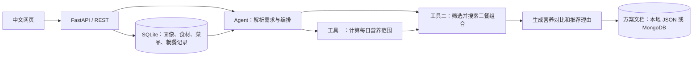

# 食序 · 智能饮食规划

面向有日常饮食管理需求的用户，提供「填写画像 → 描述饮食需求 → 生成一日三餐 → 记录实际摄入 → 查看统计」的本地课程设计原型。首次启动会初始化 21 道菜品、31 种食材和两个演示账号。

## 本地运行

需要 Python 3.11+。在项目目录执行：

```powershell
python -m pip install -r requirements.txt
python run.py
```

打开 [http://127.0.0.1:8000](http://127.0.0.1:8000)，点击 **进入演示**。也可以用 `demo`（普通成员）或 `admin`（菜库管理员）登录，密码均为 `food-demo`。管理员可添加菜品、选择食材和用量、上传菜品图片。端口被占用时可用 `python run.py --port 8001`。

初次演示建议：

1. 从个人画像设置能量目标和常设忌口，例如勾选花生。
2. 在饮食规划页输入「帮我安排三餐，清淡一点，不吃虾仁」；查看三餐克数、营养范围与搭配理由。
3. 点击某道菜的「记一餐」，录入实际份数和就餐日期。在饮食记录页查看按日期和餐次汇总的能量及规划历史。
4. 尝试「蛋奶素，不吃辣」或「高蛋白，微辣」。暂不支持的句子或忌口会提示重新输入。

API 调试入口：[Swagger UI](http://127.0.0.1:8000/docs)。业务接口使用登录接口返回的 Bearer Token。

## 组件与数据



| 组件 | 入口 | 作用 |
| --- | --- | --- |
| 前端 | `frontend/` | 独立页面、视图和 API 调用；开发时由后端顺带提供静态资源 |
| Agent | `backend/agent.py` | 使用可替换的中文规则解析目标、口味、蛋奶素、忌口和高蛋白需求；调用两个工具并解释结果 |
| 营养计算 | `backend/nutrition.py` | 根据年龄、体重、身高、计算用性别和活动量估算每日能量及三大宏量营养素范围 |
| 约束规划 | `backend/planner.py` | 画像忌口与临时忌口取并集，直接排除含这些食材的菜；再搜索早餐、午餐、晚餐和离散份数。优先满足营养范围，其次比较口味、近期重复、餐次分配和份量 |
| 关系数据库 | `backend/schema.sql`、`backend/storage.py` | 手写参数化 SQL、菜品—食材与画像—忌口多对多关系；营养视图按配方汇总，记餐保存当时的营养快照，触发器维护日×餐次统计 |
| 方案文档库 | `backend/documents.py` | 按账号保存原始需求、约束、目标、三餐明细、营养汇总和解释；方案历史按页读取 |

无法在忌口下凑齐三餐时，返回缺少的餐次，不会放宽忌口。如果能凑齐三餐，但菜库没有同时满足所有营养区间的组合，页面会将结果标为「近似方案」，标出偏离的营养项。默认示例只规划一天，每餐选一个组合餐盘；近期记录用于减少重复，不推断真实缺乏的营养。

能量计算参考 [Mifflin–St Jeor 静息能量公式](https://pubmed.ncbi.nlm.nih.gov/2305711/)；宏量营养素以 [成人 AMDR](https://www.canada.ca/en/health-canada/services/food-nutrition/healthy-eating/dietary-reference-intakes/tables/reference-values-macronutrients.html) 为参考。活动量系数、目标调整、份数和区间容差是原型参数；菜品成分为演示数据。原型仅用于课程演示，不适用于临床食谱或核验食物过敏风险。

## 存储切换

默认在 `runtime/` 中保存 SQLite 数据库、JSON 方案文档和处理后的菜品图片。文件夹由程序创建，不需要先配置数据库服务。可通过 `FOOD_DATA_DIR` 设置专用数据目录。

本机已有 MongoDB 服务时，可将方案文档切换至 MongoDB；其余业务数据仍保存在 SQLite：

```powershell
python -m pip install -r requirements-mongo.txt
$env:FOOD_MONGO_URI = "mongodb://127.0.0.1:27017"
python run.py
```

查看 `/api/health` 的 `plan_store` 确认后端；MongoDB 文档位于 `food_sequence.plans`。切换不会迁移原有方案。演示账号和本地数据都只应在课程原型环境使用。

## 验证与课程对照

```powershell
python -m pip install -r requirements-dev.txt
python -m unittest discover -s tests -v
# 先另开终端启动 python run.py
python scripts/benchmark.py --requests 100 --workers 4
```

集成测试使用隔离的临时数据目录，覆盖忌口叠加、无解处理、方案归属、记录统计、分页、权限和图片缩放。简易 HTTP 性能脚本输出成功吞吐、错误数、P50 和 P95，测试菜库分页和近 7 天统计。当前小样本试跑为每个接口 40 个请求、4 并发，两个接口均无错误；这不代表正式容量验收。

| 课件补充项 | 原型进度 |
| --- | --- |
| 非 CRUD 核心业务、前后端分离、REST | 已实现 Agent、营养目标计算和约束搜索，前端通过 HTTP JSON 接口调用 |
| 角色权限、分页、多对多 | 已实现普通成员／管理员、按账号隔离业务数据、菜库和历史分页、配方关联表 |
| 图片、汇总统计与交叉分析 | 已实现管理端图片上传、校验、缩放与重编码，以及近 7 天日期 × 餐次统计 |
| 关系库与 NoSQL | SQLite 已验证；提供 MongoDB 适配器，需在有 MongoDB 服务的环境进行联调 |
| 手写 SQL、触发器、数据库函数与存储过程 | SQLite 路径已使用手写 SQL、视图和触发器；自定义数据库函数、存储过程留给目标关系库 |
| 分库分表、每分表 10 万条数据与性能测试 | 有小样本 HTTP 基线脚本；分库分表、大样本造数和正式压测待做 |
| 国产数据库与操作系统 | 课件为建议项；本版使用 Windows 与 SQLite，可在后续迭代迁移并验证 |
| 敏捷协作、成员独立提交、远程仓库 | 实施时可按「画像与权限」「菜库与图片」「Agent 与规划」「记录与统计」切成纵向任务，每人负责对应前端、服务、数据库和文档，通过真实提交保留过程记录 |
